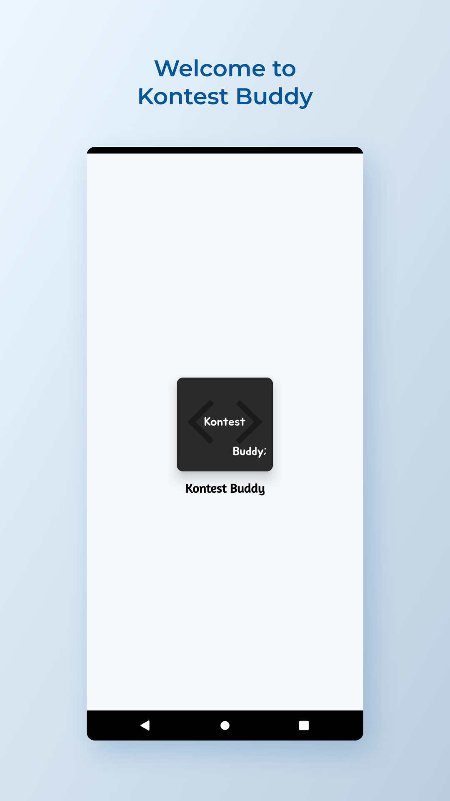
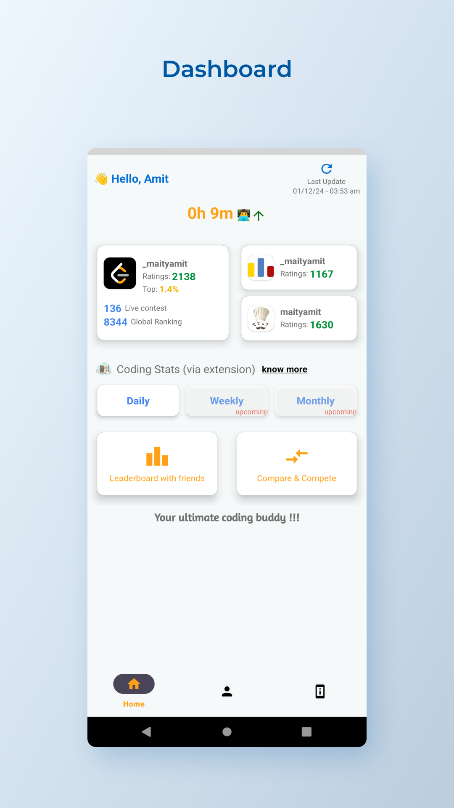
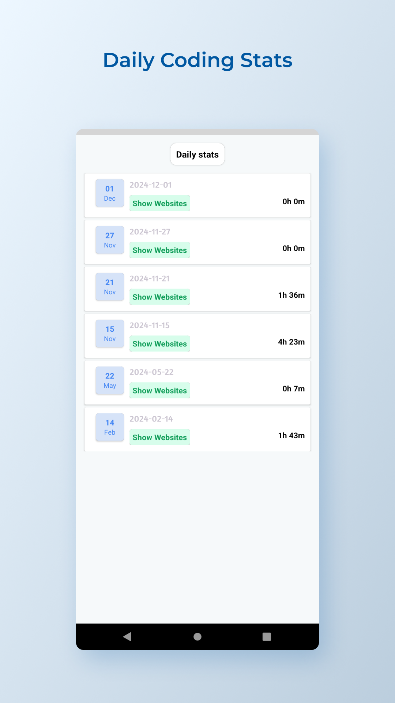
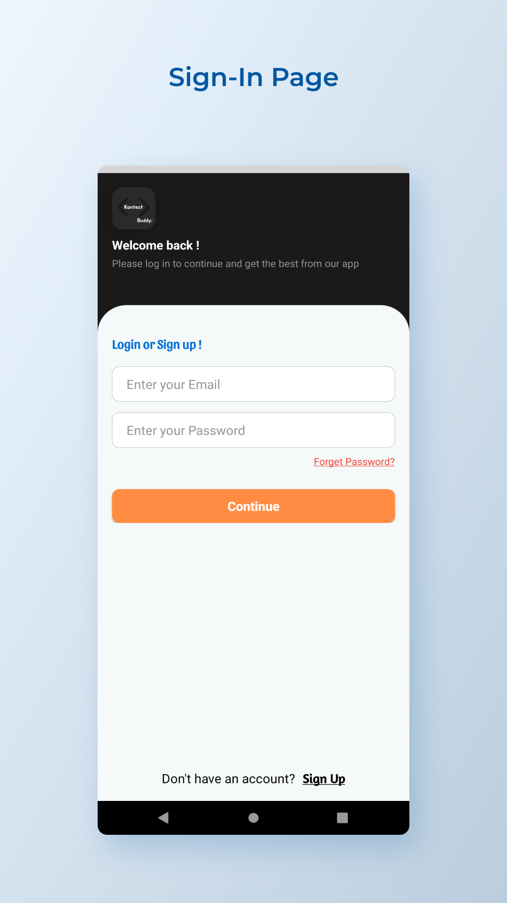
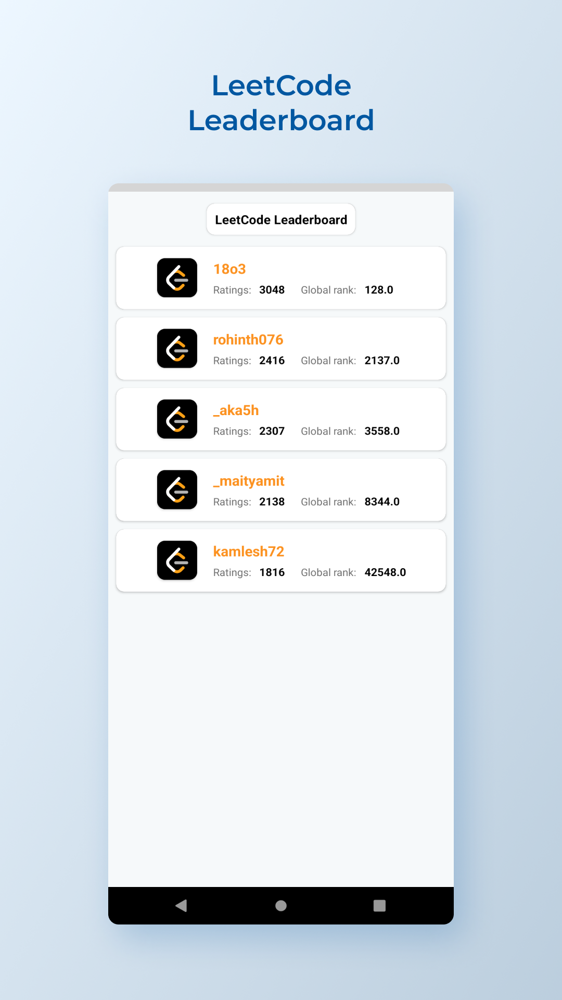
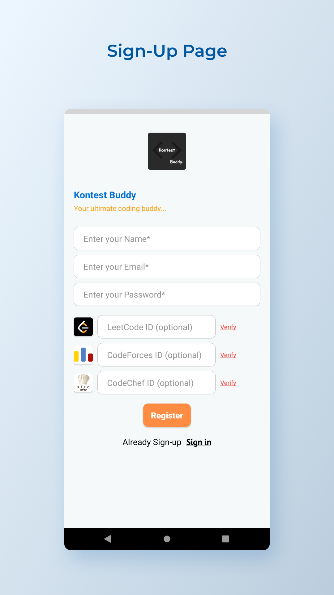

# Kontest Buddy 🚀

**Compare with your peers and compete!**

A comprehensive Android application designed for competitive programmers to track, compare, and compete across multiple coding platforms including LeetCode, CodeForces, and CodeChef.

## 🔗 Download the App [500+ Downloads]

<a href="https://play.google.com/store/apps/details?id=kontestbuddybyamitmaity.example.kontestbuddy">
</a>

## 📱 Features

### 🏆 **Multi-Platform Integration**
- **LeetCode**: Rating, global ranking, top percentage, contest participation count
- **CodeForces**: Current rating, max rating, rank, max rank
- **CodeChef**: Rating tracking and comparison

### 👥 **Social & Competitive Features**
- **User Comparison**: Side-by-side comparison of two users on LeetCode and CodeForces
- **Friends System**: Add/remove friends for each platform with real-time verification
- **Leaderboards**: Custom leaderboards with your friends for each platform
- **Coding Buddies**: Discover and connect with other competitive programmers
- **Public Profiles**: Share your progress and achievements with the community

### 📊 **Analytics & Statistics**
- **LeetCode Questions Solved Tracking**: 
  - **Daily Stats**: View questions solved each day with date-wise breakdown
  - **Monthly Stats**: Track monthly question-solving patterns and consistency
  - **Yearly Stats**: Monitor long-term progress and yearly achievements
  - **Real-time Data**: Fetches live data from LeetCode API via custom backend
  - **Visual Representation**: Clean card-based UI showing date and question count
- **Performance Analytics**: Visual representation of your coding journey
- **Real-time Updates**: Refresh your stats with the latest data
- **Progress Tracking**: Monitor your improvement over time

### 🔐 **User Management**
- **Firebase Authentication**: Secure login and registration
- **Profile Management**: Public/private profile settings
- **LinkedIn Integration**: Connect your professional profile
- **Multi-Platform Usernames**: Manage usernames for all coding platforms

## 🏗️ Architecture

### **Technology Stack**
- **Language**: Kotlin
- **Platform**: Android (minSdk 24, targetSdk 35)
- **Authentication**: Firebase Auth
- **Backend Database**: Supabase (PostgreSQL)
- **API Integration**: Custom Express.js backend
- **UI Framework**: Material Design with CardView
- **Networking**: OkHttp, Retrofit, Ktor
- **Charts**: MPAndroidChart for statistics visualization

### **Project Structure**
```
📁 app/src/main/java/kontestbuddybyamitmaity/example/kontestbuddy/
├── 📁 Auth/                    # Authentication (Login/Register)
├── 📁 Compare/                 # User comparison features
├── 📁 CurrentFriends/          # Current friends management
├── 📁 Fragment/                # Main app fragments (Home/Profile/Settings)
├── 📁 Friends/                 # Friends discovery and management
├── 📁 Notifications/           # Firebase messaging
├── 📁 questionsStats/          # LeetCode statistics and analytics
│   ├── QuestionsStatsActivity.kt    # Main stats activity
│   └── QuestionStatAdapter.kt       # RecyclerView adapter for stats
├── 📁 Ranking/                 # Leaderboard functionality
├── 📁 Services/                # API services and utilities
├── MainActivity.kt             # Main activity with bottom navigation
└── SpalshActivity.kt           # App launcher
```

## 🚀 Getting Started

### **Prerequisites**
- Android Studio Arctic Fox or later
- Android SDK 24+
- Kotlin 1.8+
- Google Play Services

### **Installation**
1. Clone the repository
   ```bash
   git clone https://github.com/yourusername/Kontest-Buddy.git
   ```

2. Open the project in Android Studio

3. Configure Firebase:
   - Add your `google-services.json` file to the `app/` directory
   - Enable Firebase Authentication in your Firebase console

4. Configure Supabase:
   - Update the Supabase URL and key in `Services/Constants.kt`
   - Set up your PostgreSQL database tables

5. Build and run the application

### **Environment Setup**
The app requires the following environment variables:
- Firebase project configuration
- Supabase database credentials
- Custom API backend URL

## 📸 Screenshots

||||
|:----------------------------------------:|:-----------------------------------------:|:-----------------------------------------: |
|  |  |  |
|  |  |  |

### 📊 **LeetCode Questions Solved Statistics**
The app provides detailed tracking of your LeetCode question-solving progress:

- **Daily View**: Shows questions solved each day with date and count
- **Monthly View**: Displays monthly patterns and consistency
- **Yearly View**: Tracks long-term progress and achievements
- **Real-time Data**: Fetches live statistics from LeetCode via custom API
- **Clean UI**: Card-based layout showing "Date" and "Questions Solved" count

## 🔧 Configuration

### **API Endpoints**
The app integrates with a custom Express.js backend for fetching coding platform data:
- Base URL: `https://express-liard-nine.vercel.app`
- **User Verification Endpoints**: 
  - `isLCExist` - Verify LeetCode username and fetch basic stats
  - `isCFExist` - Verify CodeForces username and fetch basic stats  
  - `isCCExist` - Verify CodeChef username and fetch basic stats
- **Statistics Endpoints**:
  - `lcStats` - Fetch detailed LeetCode question-solving statistics
    - Returns `dailySolved`, `monthlySolved`, `yearlySolved` JSON objects
    - Each object contains date as key and questions solved count as value
- **Comparison Endpoints**:
  - `lcCompare` - Compare two LeetCode users side-by-side
  - `cfCompare` - Compare two CodeForces users side-by-side
- **Leaderboard Endpoints**:
  - `lcLeader` - Fetch leaderboard data for multiple LeetCode users
  - `cfLeader` - Fetch leaderboard data for multiple CodeForces users
  - `ccLeader` - Fetch leaderboard data for multiple CodeChef users

### **Database Schema**
Supabase tables include:
- `users`: User profiles, usernames, and preferences
- `leaderboards`: Friend lists for each platform
- `statistics`: User performance data

## 🎨 Design

### **UI/UX Features**
- Modern Material Design with card-based layouts
- Bottom navigation with intuitive sections
- Color-coded statistics and ratings
- Responsive design with proper spacing
- Custom fonts (Amaranth, Sansita)
- Dark/light theme support

### **Design System**
- Primary Colors: Blue (#0370D6), Orange (#FFA116)
- Success Colors: Green (#009039)
- Background: Light gray (#f6f9fa)
- Cards: White with elevation and rounded corners

## 📊 Data Flow

1. **Authentication**: Firebase Auth → Supabase user creation
2. **Data Fetching**: API calls → Local storage (SharedPreferences)
3. **Real-time Updates**: Background refresh → UI updates
4. **Social Features**: Supabase queries → RecyclerView adapters
5. **Statistics**: API integration → Chart visualization
6. **LeetCode Stats Flow**:
   - User clicks Daily/Monthly/Yearly stats button
   - App calls `lcStats` API endpoint with LeetCode username
   - Backend fetches data from LeetCode and returns JSON
   - App parses `dailySolved`, `monthlySolved`, or `yearlySolved` objects
   - Data displayed in RecyclerView with `QuestionStatAdapter`
   - Each card shows date and questions solved count

## 🔒 Security & Privacy

- Firebase Authentication for secure user management
- Supabase Row Level Security (RLS) for data protection
- Local data encryption for sensitive information
- Public/private profile controls
- Secure API communication with HTTPS

## 🚀 Performance

- Efficient API caching with SharedPreferences
- Background data refresh with coroutines
- Optimized RecyclerView adapters
- Lazy loading for large datasets
- Memory-efficient image loading

## 🤝 Contributing

1. Fork the repository
2. Create a feature branch (`git checkout -b feature/AmazingFeature`)
3. Commit your changes (`git commit -m 'Add some AmazingFeature'`)
4. Push to the branch (`git push origin feature/AmazingFeature`)
5. Open a Pull Request

## 📝 License

This project is licensed under the MIT License - see the [LICENSE](LICENSE) file for details.

## 👨‍💻 Author

**Amit Maity**
- Email: maityamit307@gmail.com
- LinkedIn: [Amit Maity](https://linkedin.com/in/your-profile)

## 🙏 Acknowledgments

- LeetCode, CodeForces, and CodeChef for their APIs
- Firebase and Supabase for backend services
- Material Design for UI components
- The competitive programming community for inspiration

## 📈 Version History

- **v2.0.000_V2_Fr_QNSTAT_03** (Current)
  - Added question statistics feature
  - Enhanced friends system
  - Improved UI/UX design
  - Bug fixes and performance improvements

- **v1.x.x**
  - Initial release with basic features
  - Multi-platform integration
  - User authentication system

---

**Your ultimate coding buddy! 🚀**

*Compare, compete, and grow together with the competitive programming community.*
